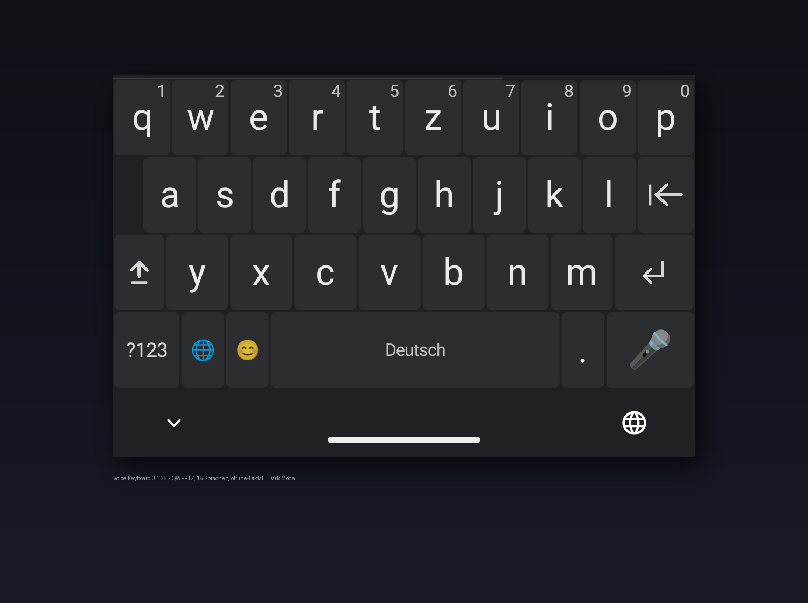

# Voice Keyboard

Android keyboard (IME) for GrapheneOS: **type in 15 languages** and **dictate offline** —
without Google services, without network access at runtime, without dictionaries or autocorrect.

<p align="center">
  
</p>

## What it can do

- Keyboard with 15 layouts (layer system: base/shift/symbol/emoji levels), look close to the system default, light and dark mode.
- Dictation via a local speech recognition model (Parakeet, int8, ~670 MB). Audio never leaves the device.
  Verified on German **and** English dictation (golden tests plus corpus harness —
  `SegmentGoldenTest`, `KorpusTaktTest`).
- One-time model download by user decision; network automatically back off afterwards.
- Microphone via hold gesture: hold = record, release = finish; status and errors in the status row.

## Privacy

No telemetry provider, no crash reports, no word lists. The only
network permission exists for the one-time model download. Diagnostic fields (🐞) show
only measurements such as level, time and path type — never audio or text content.

## Build

```
export ANDROID_HOME=/opt/android-sdk
./gradlew --offline assembleRelease      # APK
./gradlew --offline testDebugUnitTest    # unit tests
```
Requires Android SDK 35 and arm64 target devices. The release signing key is not
included.

## Status

Early stage (0.1.x), development verified on a real device. Dictation works
in German; other languages need their own recognition models. See `docs/` for
concept, layout requirements and the ASR contract.
